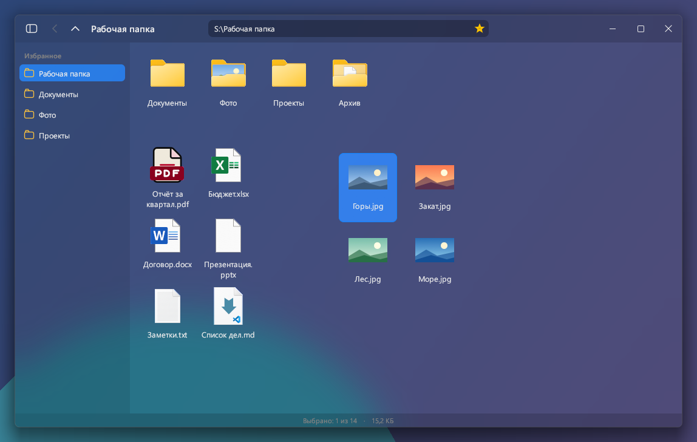
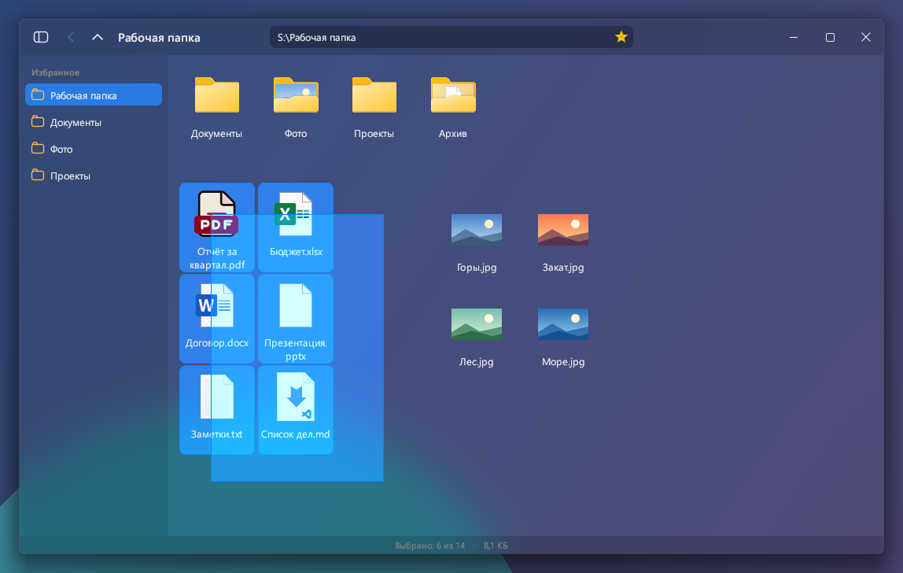

<p align="center">
  
</p>

<h1 align="center">CanExp</h1>

<p align="center">
  A file explorer for Windows where you can arrange files inside a folder freely — just like on the desktop.
</p>

<p align="center">
  <b>English</b> · <a href="README.ru.md">Русский</a>
</p>



## Why

The regular File Explorer shows a folder as a grid or a list and decides the order of files for you. CanExp turns every folder into a canvas: drag files wherever you like, keep documents in one corner and pictures in another — and the folder opens exactly the same way next time.

> The interface is currently in Russian.

## Features

- **Free layout.** Drag files and folders anywhere on the canvas; positions are remembered per folder.
- **Group move.** Select several files and drag them together — their relative arrangement is kept.
- **Explorer-style selection.** Click, Ctrl+click, Shift+click (range) and rubber-band selection.
- **Previews.** Photo, video and PDF thumbnails come from Windows itself — the same ones File Explorer shows; other files get their system icons. Thumbnails load in the background and never freeze the window.
- **Favorites.** The star in the address bar adds the folder to the sidebar; the sidebar toggles with a button at the left of the title bar.
- **Selection size** in the status bar — instantly for files, and computed in the background for folders, including everything inside.
- **Its own `.cexp` layout file.** Double-click it in the regular File Explorer to open that folder in CanExp.
- **Translucent window** with the Windows 11 acrylic backdrop; light and dark theme follow the system setting.



## Controls

| Action | How |
| --- | --- |
| Open a file or enter a folder | Double-click |
| Select | Click |
| Add to / remove from selection | Ctrl + click |
| Select a range | Shift + click |
| Rubber-band select | Drag from an empty spot (with Ctrl or Shift — add to the selection) |
| Move | Drag a file; if it is selected, the whole selection moves |
| Go to a path | Type it in the address bar and press Enter |
| Back / up one level | Arrows at the left of the title bar |
| Add folder to favorites | Star in the address bar |
| Remove from favorites | Right-click the folder in the sidebar |
| Show / hide the sidebar | Button to the left of "back" |

## Where data is stored

- **Folder layout** — a `folder.cexp` file inside the folder itself (plain JSON with coordinates). It is created only after you move something, and travels with the folder when you copy or archive it. CanExp itself doesn't show it.
- **Favorites and window settings** — `%APPDATA%\CanExp\settings.json`.
- **`.cexp` file association** — registered on startup under `HKEY_CURRENT_USER\Software\Classes` (no admin rights needed).

## Building

You need:

- Windows 10 or 11 (the acrylic backdrop requires Windows 11 22H2 or newer; on older systems the window is simply dark);
- [Rust](https://rustup.rs) (stable, MSVC toolchain);
- Visual Studio Build Tools with the "Desktop development with C++" workload — it also installs the Windows SDK with `rc.exe`, which embeds the icon into the exe.

```powershell
git clone https://github.com/KornebQ/CanExp.git
cd CanExp
cargo build --release
```

The program is `target\release\canexp.exe`. Run it without arguments (opens your user folder), with a folder path, or with a path to a `.cexp` file.

```powershell
cargo test
```

## Known limitations

- No drag-and-drop between CanExp and the regular File Explorer, no Explorer context menu, no rename or delete.
- Files can overlap — the canvas is free-form, there is no snap-to-grid.
- Dragging the selection rectangle to the window edge doesn't auto-scroll.
- The layout can't be saved in folders without write access (e.g. `C:\Program Files`) — the app shows an error.
- Thumbnails load in folder order, not visible-first.

## Under the hood

Rust + [egui/eframe](https://github.com/emilk/egui), Windows API via the [`windows`](https://github.com/microsoft/windows-rs) crate.

| File | Contents |
| --- | --- |
| `src/main.rs` | window, canvas, selection, dragging, sidebar, layout and settings |
| `src/icons.rs` | thumbnails and icons via `IShellItemImageFactory` on a background thread |
| `src/sizes.rs` | folder size calculation in the background |
| `src/style.rs` | font, colors, acrylic window backdrop |
| `build.rs` | embedding the icon into the exe |

## License

[MIT](LICENSE)
