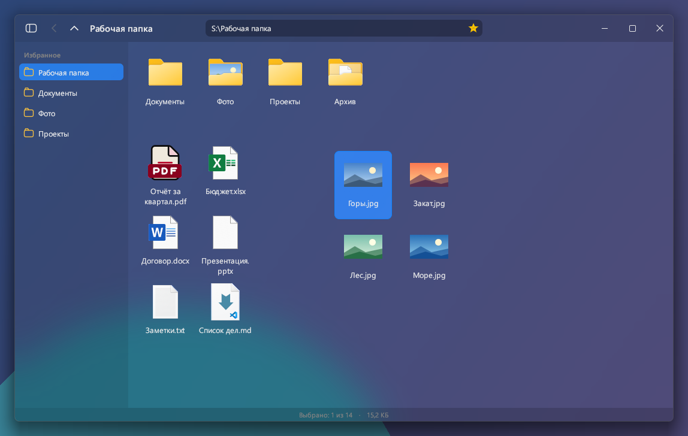
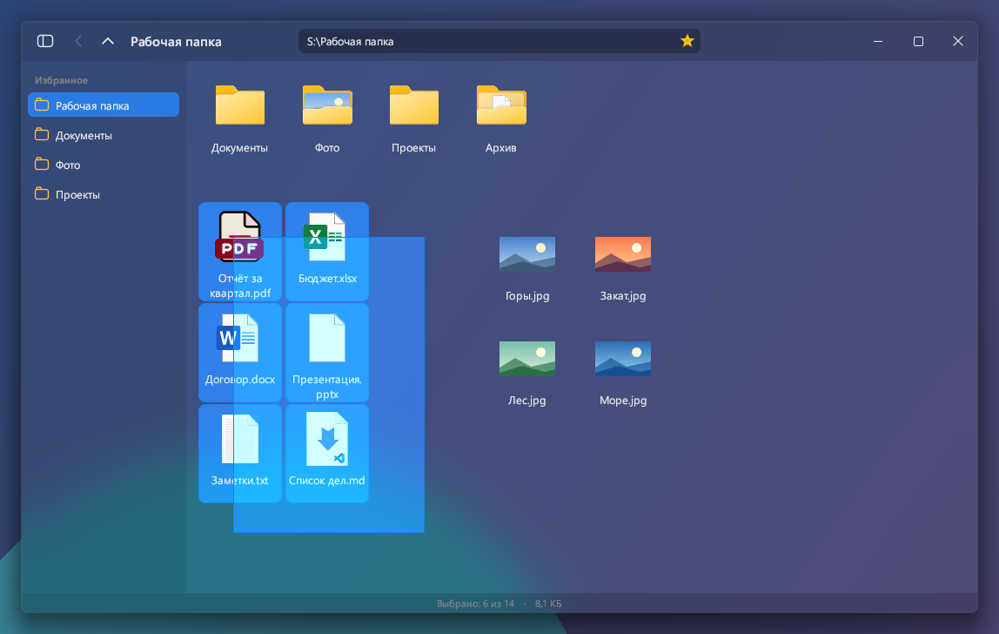

<p align="center">
  
</p>

<h1 align="center">CanExp</h1>

<p align="center">
  Проводник для Windows, в котором файлы внутри папки можно раскладывать свободно — как на рабочем столе.
</p>

<p align="center">
  <a href="README.md">English</a> · <b>Русский</b>
</p>



## Зачем

Обычный Проводник показывает папку как сетку или список и сам решает, в каком порядке стоят файлы. CanExp превращает каждую папку в холст: перетащите файлы куда удобно, сгруппируйте документы в одном углу, картинки в другом — и в следующий раз папка откроется ровно такой же.

## Возможности

- **Свободная раскладка.** Файлы и папки перетаскиваются в любое место холста; позиции запоминаются для каждой папки.
- **Групповое перемещение.** Выделите несколько файлов и перетащите их вместе — взаимное расположение сохранится.
- **Выделение как в Проводнике.** Клик, Ctrl+клик, Shift+клик (диапазон) и выделение рамкой.
- **Превью.** Миниатюры фото, видео и PDF берутся из Windows — те же, что в обычном Проводнике; у остальных файлов системные иконки. Загружаются в фоне и не тормозят окно.
- **Избранное.** Звезда в адресной строке добавляет папку в боковую панель; панель скрывается кнопкой слева в заголовке.
- **Размер выделенного** в строке состояния — для файлов сразу, для папок считается в фоне вместе со всем содержимым.
- **Свой файл раскладки `.cexp`.** Двойной клик по нему в обычном Проводнике открывает эту папку в CanExp.
- **Полупрозрачное окно** с акриловым фоном Windows 11, светлая и тёмная темы по системной настройке.



## Управление

| Действие | Как |
| --- | --- |
| Открыть файл или войти в папку | Двойной клик |
| Выделить | Клик |
| Добавить к выделению / убрать | Ctrl + клик |
| Выделить диапазон | Shift + клик |
| Выделить рамкой | Тянуть мышью с пустого места (с Ctrl или Shift — добавить к выделению) |
| Переместить | Тянуть файл; если он выделен — едет всё выделение |
| Перейти по пути | Ввести путь в адресной строке и нажать Enter |
| Назад / на уровень вверх | Стрелки слева в заголовке |
| Добавить папку в избранное | Звезда в адресной строке |
| Убрать из избранного | Правый клик по папке в боковой панели |
| Показать / скрыть боковую панель | Кнопка слева от «назад» |

## Где хранятся данные

- **Раскладка папки** — файл `folder.cexp` внутри самой папки (обычный JSON с координатами). Создаётся только после того, как вы что-то передвинули, и путешествует вместе с папкой при копировании и архивации. В самом CanExp он не показывается.
- **Избранное и настройки окна** — `%APPDATA%\CanExp\settings.json`.
- **Привязка расширения `.cexp`** — регистрируется при запуске в `HKEY_CURRENT_USER\Software\Classes` (права администратора не нужны).

## Сборка

Нужны:

- Windows 10 или 11 (акриловый фон — Windows 11 22H2 и новее; на более старых окно просто тёмное);
- [Rust](https://rustup.rs) (stable, toolchain MSVC);
- Visual Studio Build Tools с компонентом «Разработка классических приложений на C++» — он же ставит Windows SDK с `rc.exe`, через который в exe встраивается иконка.

```powershell
git clone https://github.com/KornebQ/CanExp.git
cd CanExp
cargo build --release
```

Готовая программа — `target\release\canexp.exe`. Её можно запускать без аргументов (откроется папка пользователя), с путём к папке или с путём к файлу `.cexp`.

```powershell
cargo test
```

## Известные ограничения

- Нет перетаскивания файлов между CanExp и обычным Проводником, нет контекстного меню Проводника, переименования и удаления.
- Файлы могут лежать друг на друге — холст свободный, сетки-«магнита» нет.
- Если тянуть рамку выделения к краю окна, список не прокручивается сам.
- В папку без права записи (например, `C:\Program Files`) раскладку сохранить нельзя — программа покажет ошибку.
- Миниатюры загружаются в порядке файлов в папке, а не начиная с видимых.

## Устройство

Rust + [egui/eframe](https://github.com/emilk/egui), Windows API через крейт [`windows`](https://github.com/microsoft/windows-rs).

| Файл | Что внутри |
| --- | --- |
| `src/main.rs` | окно, холст, выделение, перетаскивание, боковая панель, раскладка и настройки |
| `src/icons.rs` | миниатюры и иконки через `IShellItemImageFactory` в фоновом потоке |
| `src/sizes.rs` | подсчёт размера папок в фоне |
| `src/style.rs` | шрифт, цвета, акриловый фон окна |
| `build.rs` | встраивание иконки в exe |

## Лицензия

[MIT](LICENSE)
