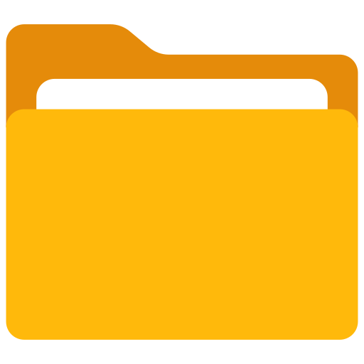
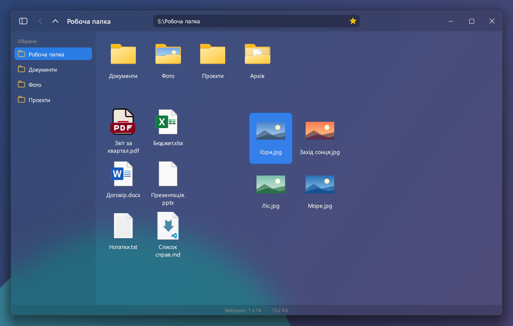
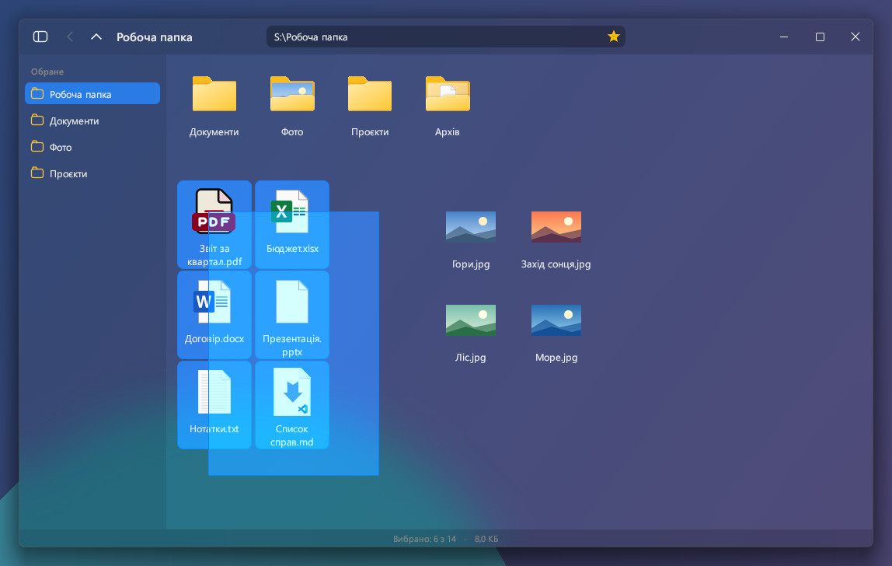

<p align="center">
  
</p>

<h1 align="center">CanExp</h1>

<p align="center">
  Провідник для Windows, у якому файли всередині папки можна розкладати вільно — як на робочому столі.
</p>

<p align="center">
  <a href="README.md">English</a> · <b>Українська</b>
</p>



## Навіщо

Звичайний Провідник показує папку як сітку або список і сам вирішує, у якому порядку стоять файли. CanExp перетворює кожну папку на полотно: перетягніть файли куди зручно, згрупуйте документи в одному куті, а зображення в іншому — і наступного разу папка відкриється точно так само.

> Інтерфейс доступний українською, англійською та російською й підлаштовується під мову Windows. Щоб вибрати мову самостійно, задайте змінну середовища `CANEXP_LANG` зі значенням `uk`, `en` або `ru`.

## Можливості

- **Вільна розкладка.** Файли й папки перетягуються в будь-яке місце полотна; позиції запам'ятовуються для кожної папки.
- **Групове переміщення.** Виділіть кілька файлів і перетягніть їх разом — взаємне розташування збережеться.
- **Перетягування між програмами.** Витягніть файли за край вікна й киньте в браузер, месенджер, іншу папку Провідника — будь-куди, що приймає файли з Провідника. Файли, кинуті в CanExp, потрапляють у відкриту папку точно туди, куди їх кинули: з того самого диска переміщуються, з іншого копіюються — як у Провіднику.
- **Виділення як у Провіднику.** Клік, Ctrl+клік, Shift+клік (діапазон) і виділення рамкою.
- **Попередній перегляд.** Мініатюри фото, відео й PDF беруться з Windows — ті самі, що у звичайному Провіднику; решта файлів має системні значки. Завантажуються у фоні й не гальмують вікно.
- **Обране.** Зірка в адресному рядку додає папку на бічну панель; панель ховається кнопкою ліворуч у заголовку.
- **Розмір виділеного** в рядку стану — для файлів одразу, для папок рахується у фоні разом з усім вмістом.
- **Власний файл розкладки `.cexp`.** Подвійний клік по ньому у звичайному Провіднику відкриває цю папку в CanExp.
- **Напівпрозоре вікно** з акриловим фоном Windows 11, світла й темна теми за системним налаштуванням.



## Керування

| Дія | Як |
| --- | --- |
| Відкрити файл або увійти в папку | Подвійний клік |
| Виділити | Клік |
| Додати до виділення / прибрати | Ctrl + клік |
| Виділити діапазон | Shift + клік |
| Виділити рамкою | Тягнути мишею з порожнього місця (з Ctrl або Shift — додати до виділення) |
| Перемістити | Тягнути файл; якщо він виділений — їде все виділення |
| Перемістити в папку | Кинути файли на папку на полотні або на бічній панелі; з Ctrl — скопіювати |
| Перейти за шляхом | Ввести шлях в адресному рядку й натиснути Enter |
| Назад / на рівень вище | Стрілки ліворуч у заголовку |
| Додати папку до обраного | Зірка в адресному рядку |
| Прибрати з обраного | Правий клік по папці на бічній панелі |
| Показати / сховати бічну панель | Кнопка ліворуч від «назад» |

## Де зберігаються дані

- **Розкладка папки** — файл `folder.cexp` усередині самої папки (звичайний JSON з координатами). Створюється лише після того, як ви щось пересунули, і переїжджає разом із папкою під час копіювання та архівації. У самому CanExp він не показується.
- **Обране й налаштування вікна** — `%APPDATA%\CanExp\settings.json`.
- **Прив'язка розширення `.cexp`** — реєструється під час запуску в `HKEY_CURRENT_USER\Software\Classes` (права адміністратора не потрібні).

## Збирання

Потрібні:

- Windows 10 або 11 (акриловий фон — Windows 11 22H2 і новіші; на старіших вікно просто темне);
- [Rust](https://rustup.rs) (stable, toolchain MSVC);
- Visual Studio Build Tools з компонентом «Розробка класичних застосунків на C++» — він же встановлює Windows SDK з `rc.exe`, через який в exe вбудовується значок.

```powershell
git clone https://github.com/KornebQ/CanExp.git
cd CanExp
cargo build --release
```

Готова програма — `target\release\canexp.exe`. Її можна запускати без аргументів (відкриється папка користувача), зі шляхом до папки або зі шляхом до файлу `.cexp`.

```powershell
cargo test
```

## Відомі обмеження

- Немає контекстного меню Провідника, перейменування й видалення.
- Файли можуть лежати один на одному — полотно вільне, сітки-«магніту» немає.
- Якщо тягнути рамку виділення до краю вікна, список не прокручується сам.
- У папку без права запису (наприклад, `C:\Program Files`) розкладку зберегти не можна — програма покаже помилку.
- Мініатюри завантажуються в порядку файлів у папці, а не починаючи з видимих.

## Устрій

Rust + [egui/eframe](https://github.com/emilk/egui), Windows API через крейт [`windows`](https://github.com/microsoft/windows-rs).

| Файл | Що всередині |
| --- | --- |
| `src/main.rs` | вікно, полотно, виділення, перетягування, бічна панель, розкладка й налаштування |
| `src/icons.rs` | мініатюри й значки через `IShellItemImageFactory` у фоновому потоці |
| `src/sizes.rs` | підрахунок розміру папок у фоні |
| `src/dnd.rs` | перетягування між програмами |
| `src/lang.rs` | мова інтерфейсу |
| `src/style.rs` | шрифт, кольори, акриловий фон вікна |
| `build.rs` | вбудовування значка в exe |

## Ліцензія

[MIT](LICENSE)
